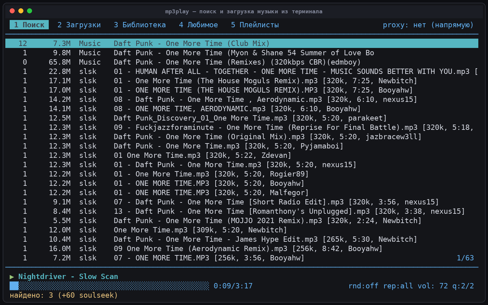
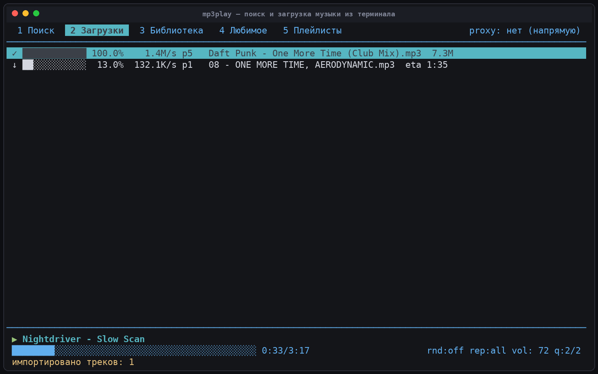

# mp3player — a terminal music player: BitTorrent + SoulSeek

**English** | **[Русский](README.md)**

Searches two public torrent indexes and the SoulSeek network at once, downloads
with its own protocol clients (no libtorrent, no external dependencies), builds
a tagged local library with cover art — and plays it all without leaving the
curses interface.





## Features

- **Search** — apibay (The Pirate Bay) and solidtorrents queried in parallel,
  plus the live SoulSeek network; results merged into a single list with
  bitrates, seeders, free slots and queue lengths.
- **Own BitTorrent client on the pure standard library** — bencode, magnets,
  the BEP 3 peer protocol, BEP 9 metadata exchange, BEP 10/11 extensions
  (ut_metadata, ut_pex), HTTP trackers, selective file download.
  Zero pip dependencies.
- **Own SoulSeek client** — login, search, peer queues, downloads, resume
  after connection drops. No open listening port required: everything works
  over outbound connections (ConnectToPeer → PierceFirewall).
- **A proxy carries everything** — HTTP CONNECT or SOCKS5/`socks5h` picked up
  from the environment (`http_proxy`/`https_proxy`/`all_proxy`) or from the
  config: search, tracker announces, peer connections and SoulSeek all go
  through a single tunnel.
- **Library** — downloads are transcoded to mp3 320k (or remuxed losslessly),
  get ID3 tags and cover art; likes, playlists and play history live in
  SQLite. The library folder can be changed right in the UI — existing tracks
  are moved and the database updated.
- **Player** — ffplay transport: pause, seek, volume, shuffle, repeat.

## Requirements

- Linux/macOS, a UTF-8 terminal
- Python 3.10+ (standard library only)
- ffmpeg + ffprobe + ffplay

## Quick start

```bash
./mp3play --check   # verifies ffmpeg, the proxy, search and SoulSeek reachability
./mp3play           # run the TUI
./mp3play -q "daft punk one more time"   # search right at startup
```

Press `/`, type a query — results from all sources appear in one list. `Enter`
on a row starts the download. To pull a single track out of a torrent album:
`Enter` on the download opens the file list, `p` means "download and play".

## Keys

| Key               | Action                                            |
|-------------------|---------------------------------------------------|
| `/`               | search (torrents + soulseek)                      |
| `1..5`, Tab       | tabs: Search / Downloads / Library / Liked / Playlists |
| `Enter`           | on a result — download; on a download — files; on a track — play |
| `j`/`k`, arrows, PgUp/PgDn, `g`/`G` | navigation                  |
| `d`, Ctrl-D       | cancel a download / remove from a playlist        |
| `L`               | change the library folder (directory browser + track moving) |
| `l`               | like the track under the cursor or the playing one |
| `a`, `N`          | add to a playlist / create a playlist             |
| `Space` `n` `p`   | pause, next, previous                             |
| `←`/`→`, `,`/`.`, `<`/`>` | seek ±5/10/30 s                          |
| `+`/`-`           | volume                                            |
| `s`, `R`          | shuffle, repeat mode                              |
| `r`               | refresh (repeat the search / the library)         |
| `?`, `q`          | help, quit                                        |

## Command line

```
--config PATH      custom config.json path
--proxy URL        proxy for all traffic (http/https/socks5/socks5h)
--no-proxy         go direct, ignore environment variables
--no-slsk          disable SoulSeek (torrents only)
--download-dir DIR where to put raw downloads
--library-dir DIR  where finished mp3 files live
--max-peers N      peer pool size per torrent (default 40)
--bitrate RATE     transcode bitrate (default 320k)
-q, --query QUERY  run a search at startup
--check            self-test of the environment and services
--write-config     save current settings to config.json
```

## Configuration

`~/.config/mp3player/config.json` (created on first run; see
[config.example.json](config.example.json)):

| Field                   | Meaning                                             |
|-------------------------|-----------------------------------------------------|
| `proxy` / `search_proxy`| `"auto"` (from env), a proxy URL, or `""` (direct)  |
| `download_dir`          | where in-progress torrents and soulseek files live  |
| `library_dir`           | the library folder (also changeable in the TUI via `L`) |
| `mp3_bitrate`           | mp3 bitrate for FLAC etc. conversion                |
| `keep_torrent_data`     | keep raw files after importing into the library     |
| `max_peers`             | peer pool size per torrent                          |
| `slsk_enabled`          | use SoulSeek                                        |
| `slsk_user`, `slsk_pass`| the SoulSeek account                                |

### The SoulSeek account

On first run an account (`mp3player_xxx`) is generated and saved to the config —
it is a permanent SoulSeek network identity used for search and downloads. You
can substitute your own `slsk_user`/`slsk_pass`: if the name does not exist it
gets registered at first login (passwords cannot be recovered). The Soulseek
server disallows mass registration of random names, so the account is reused
across runs.

The client shares nothing, so some peers put it in a low-priority queue — that
is normal network behaviour; large result lists usually contain enough peers
with free slots.

## Internals

| Module            | Responsibility                                                        |
|-------------------|-----------------------------------------------------------------------|
| `mp3p/bencode.py` | bencode codec                                                         |
| `mp3p/torrent.py` | metadata: magnets, .torrent, files/pieces                             |
| `mp3p/tracker.py` | HTTP announces (parallel, peers handed over incrementally)            |
| `mp3p/peer.py`    | BEP 3 peer protocol + BEP 9/10/11                                     |
| `mp3p/downloader.py` | torrent session: piece picking, disk, peer pool                    |
| `mp3p/slsk.py`    | SoulSeek client: server, search, P/F connections, downloads           |
| `mp3p/net.py`     | proxy tunnels (HTTP CONNECT, SOCKS5) and the HTTP client              |
| `mp3p/search.py`  | torrent index search with merging                                     |
| `mp3p/media.py`   | ffprobe/ffmpeg: tags, covers, mp3 conversion                          |
| `mp3p/library.py` | SQLite: tracks, likes, playlists, history                             |
| `mp3p/player.py`  | ffplay transport (pause = SIGSTOP/SIGCONT, seek via restart)          |
| `mp3p/ui.py`      | the curses interface                                                  |

Download speed is squeezed out of pure Python where it can be: a piece is
pinned to one peer while it makes progress and handed to a second one only
after a 10 s stall (requesting just the missing blocks); SHA1 hashing and disk
writes happen outside the session lock; the request window is 96 blocks per
peer. On a direct connection a 399 MB FLAC album sustains ~5 MB/s average with
peaks near 10 MB/s.

## Proxy

The proxy is taken from the environment (`http_proxy`, `https_proxy`,
`all_proxy`) or set explicitly (`--proxy socks5h://127.0.0.1:9050`). Behind an
HTTP proxy, UDP trackers and DHT are fundamentally unavailable, so peers are
found via HTTP trackers and peer exchange (ut_pex), while SoulSeek works
entirely over outbound connections. No open port is needed for either torrents
or SoulSeek.

---

This project is for personal use: respect copyright and the rules of the
Soulseek network.

## License

[MIT](LICENSE)
