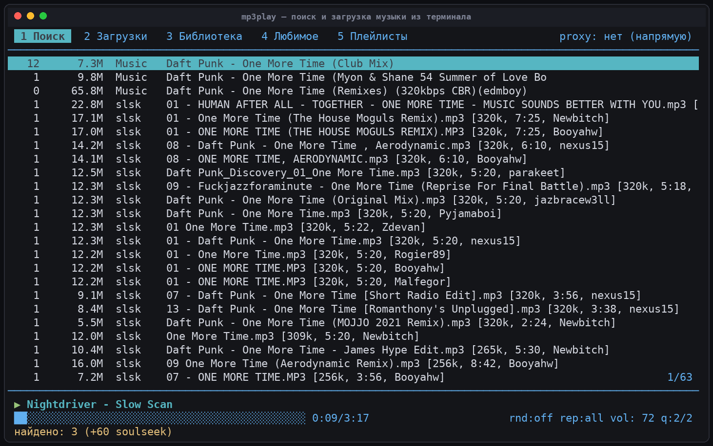
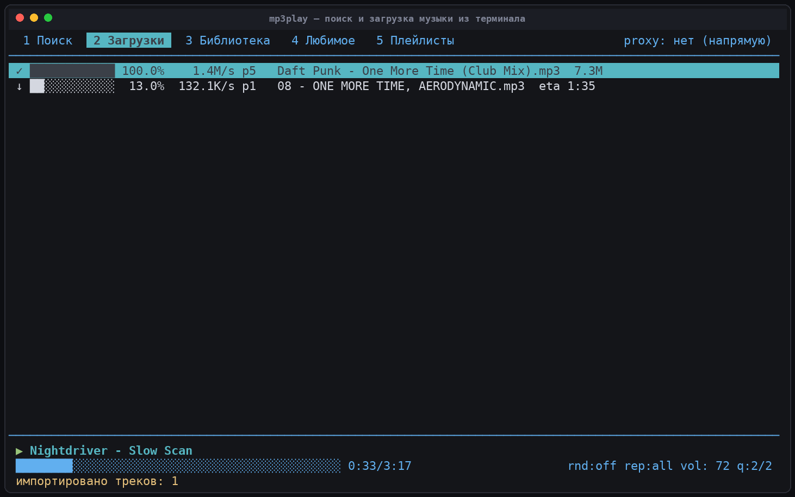

# mp3player — музыкальный плеер в терминале: BitTorrent + SoulSeek

**[English](README.en.md)** | **Русский**

Ищет треки сразу по двум torrent-индексам и сети SoulSeek, качает их собственными
клиентами протоколов (без libtorrent и без внешних зависимостей), сам собирает
библиотеку с тегами и обложками — и играет, не выходя из curses-интерфейса.





## Возможности

- **Поиск** — apibay (The Pirate Bay) и solidtorrents параллельно, плюс живая
  сеть SoulSeek; результаты мержатся в один список с битрейтами, сидами,
  свободными слотами и длиной очереди.
- **Свой BitTorrent-клиент на чистой stdlib** — bencode, magnet-ссылки,
  peer-протокол BEP 3, обмен метаданными BEP 9, расширения BEP 10/11
  (ut_metadata, ut_pex), HTTP-трекеры, селективная загрузка файлов.
  Никаких pip-зависимостей — только стандартная библиотека Python.
- **Свой клиент SoulSeek** — логин, поиск, очередь у пира, загрузка, докачка
  после обрыва. Клиенту не нужен открытый порт: всё работает через исходящие
  соединения (ConnectToPeer → PierceFirewall).
- **Прокси везде** — HTTP CONNECT или SOCKS5/`socks5h` из переменных окружения
  (`http_proxy`/`https_proxy`/`all_proxy`) или из конфига: поиск, announce,
  соединения к пирам и SoulSeek идут одним туннелем.
- **Библиотека** — скачанное конвертируется в mp3 320k (или ремуксится без
  потери качества), получает ID3-теги и обложку; лайки, плейлисты, история
  прослушиваний в SQLite. Папку библиотеки можно сменить прямо в плеере —
  с переносом уже скачанных треков.
- **Плеер** — ffplay-транспорт: пауза, seek, громкость, шаффл, повтор.

## Требования

- Linux/macOS, терминал с поддержкой UTF-8
- Python 3.10+ (только стандартная библиотека)
- ffmpeg + ffprobe + ffplay (в Arch: `sudo pacman -S ffmpeg`)

## Быстрый старт

```bash
./mp3play --check   # проверит ffmpeg, прокси, поиск и достижимость SoulSeek
./mp3play           # запуск TUI
./mp3play -q "daft punk one more time"   # сразу искать при старте
```

Нажмите `/`, введите запрос — результаты появятся одним списком. `Enter` на
строке — загрузка. Для отдельного трека из альбома-торрента: `Enter` на загрузке
открывает список файлов, `p` — «качать и играть».

## Клавиши

| Клавиша      | Действие                                          |
|--------------|---------------------------------------------------|
| `/`          | поиск (торренты + soulseek)                       |
| `1..5`, Tab  | вкладки: Поиск / Загрузки / Библиотека / Любимое / Плейлисты |
| `Enter`      | на результате — качать; на загрузке — файлы; на треке — играть |
| `j`/`k`, стрелки, PgUp/PgDn, `g`/`G` | навигация                |
| `d`, Ctrl-D  | отменить загрузку / удалить из плейлиста          |
| `L`          | сменить папку библиотеки (обзор каталогов + перенос треков) |
| `l`          | лайк трека под курсором или играющего              |
| `a`, `N`     | добавить в плейлист / создать плейлист            |
| `Space` `n` `p` | пауза, следующий, предыдущий                   |
| `←`/`→`, `,`/`.`, `<`/`>` | перемотка ±5/10/30 c                  |
| `+`/`-`      | громкость                                         |
| `s`, `R`     | шаффл, режим повтора                              |
| `r`          | обновить (повторить поиск / библиотеку)           |
| `?`, `q`     | справка, выход                                    |

## Аргументы командной строки

```
--config PATH      свой путь к config.json
--proxy URL        прокси для всего трафика (http/https/socks5/socks5h)
--no-proxy         работать напрямую, игнорируя переменные окружения
--no-slsk          отключить SoulSeek (только торренты)
--download-dir DIR куда качать сырье
--library-dir DIR  куда складывать готовые mp3
--max-peers N      максимум пиров на торрент (по умолчанию 40)
--bitrate RATE     битрейт конвертации (по умолчанию 320k)
-q, --query QUERY  выполнить поиск при старте
--check            самопроверка окружения и доступности сервисов
--write-config     сохранить текущие параметры в config.json
```

## Конфигурация

`~/.config/mp3player/config.json` (создаётся при первом запуске, пример —
[config.example.json](config.example.json)):

| Поле                    | Значение                                                    |
|-------------------------|-------------------------------------------------------------|
| `proxy` / `search_proxy`| `"auto"` (из env), URL прокси или `""` (напрямую)           |
| `download_dir`          | где лежат недокачанные торренты и файлы soulseek            |
| `library_dir`           | папка библиотеки (меняется и из TUI по `L`)                 |
| `mp3_bitrate`           | битрейт mp3 при конвертации FLAC и прочих                   |
| `keep_torrent_data`     | не удалять исходные файлы после импорта в библиотеку        |
| `max_peers`             | размер пула пиров на торрент                                 |
| `slsk_enabled`          | использовать SoulSeek                                        |
| `slsk_user`, `slsk_pass`| учётная запись SoulSeek                                      |

### Учётная запись SoulSeek

При первом запуске генерируется учётная запись (`mp3player_xxx`) и сохраняется
в конфиг — это постоянная запись сети SoulSeek, она нужна для поиска и
загрузок. Можно вписать свои `slsk_user`/`slsk_pass`: если имени не существует,
оно регистрируется при первом входе (пароль восстановлению не подлежит).
Сервер Soulseek не разрешает массовую регистрацию случайных имён, поэтому
аккаунт переиспользуется во всех запусках.

Клиент заявляет нулевую шару, поэтому некоторые пиры ставят его в очередь с
низким приоритетом — это нормальное поведение сети; списки с большим числом
результатов обычно содержат достаточно пиров со свободными слотами.

## Как устроено

| Модуль            | Ответственность                                                       |
|-------------------|-----------------------------------------------------------------------|
| `mp3p/bencode.py` | кодек bencode                                                         |
| `mp3p/torrent.py` | метаданные: magnet, .torrent, файлы/кусы                              |
| `mp3p/tracker.py` | HTTP-аннунсы (параллельно, с инкрементальной отдачей пиров)           |
| `mp3p/peer.py`    | peer-протокол BEP 3 + BEP 9/10/11                                     |
| `mp3p/downloader.py` | сессия торрента: выбор кусков, диск, пул пиров                     |
| `mp3p/slsk.py`    | клиент SoulSeek: сервер, поиск, P/F-соединения, закачки              |
| `mp3p/net.py`     | прокси-туннели (HTTP CONNECT, SOCKS5) и HTTP-клиент                  |
| `mp3p/search.py`  | поиск по торрент-индексам с мержем                                   |
| `mp3p/media.py`   | ffprobe/ffmpeg: теги, обложки, конвертация в mp3                     |
| `mp3p/library.py` | SQLite: треки, лайки, плейлисты, история                             |
| `mp3p/player.py`  | ffplay-транспорт (пауза = SIGSTOP/SIGCONT, seek перезапуском)        |
| `mp3p/ui.py`      | curses-интерфейс                                                      |

Скорость закачки выжимается из чистого Python как умеет: кусок закреплён за
одним пиром, пока «дышит», и передаётся второму после 10 с простоя (только
недостающими блоками); SHA1 и запись куска выполняются вне блокировки сессии;
окно запросов — 96 блоков на пира. На прямом канале альбом FLAC 399 МБ
набирает ~5 МБ/с в среднем с пиками под 10 МБ/с.

## Прокси

Прокси подхватывается из окружения (`http_proxy`, `https_proxy`, `all_proxy`)
или задаётся явно (`--proxy socks5h://127.0.0.1:9050`). Через HTTP-прокси
UDP-трекеры и DHT недоступны принципиально, поэтому пиры ищутся через
HTTP-трекеры и peer exchange (ut_pex), а SoulSeek работает полностью через
исходящие соединения. Открытый порт не нужен ни для торрентов, ни для SoulSeek.

---

Проект — для личного использования: уважайте авторские права и правила сети
Soulseek.
